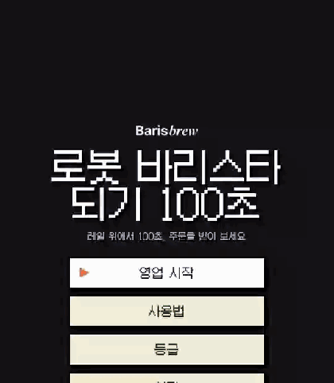
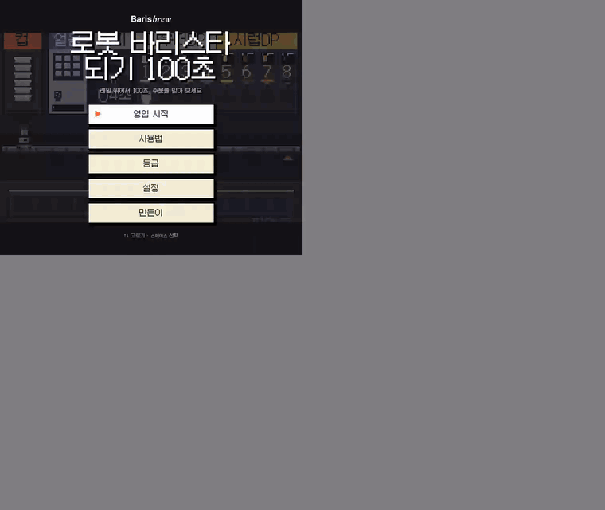
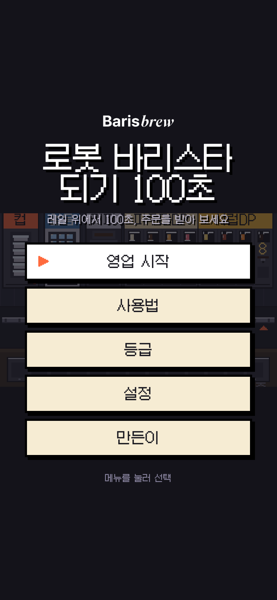
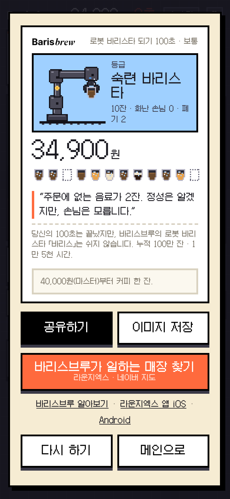

# 로봇 바리스타 되기 100초

바리스브루(XYZ의 로봇 바리스타 솔루션) 홍보용 픽셀아트 미니게임. 레일 위 로봇 팔이 되어 100초 동안 주문을 받고, 컵을 집고, 기계에 걸어 두고 다음 컵을 집는다.

**플레이:** https://jun-xyz.github.io/baris-game/ — PC 웹(키보드)과 모바일 웹(터치 버튼) 둘 다 됩니다.

| 모바일 웹 | PC 웹 |
| --- | --- |
|  |  |

한 판 전체 영상 — [모바일 docs/play.mp4](docs/play.mp4) · [PC docs/play-web.mp4](docs/play-web.mp4). 영상 속 플레이어는 녹화용 봇이라 등급은 숙련 바리스타.

| 타이틀 | 결과 카드 |
| --- | --- |
|  |  |

## 어떻게 하나

```
주문 카드의 아이콘 순서가 레시피
  얼음 · 커피 → 그 기계로        재료 → 아이콘에 적힌 번호의 노즐로
도착해서 동작 → 컵이 걸림        걸어 둔 컵은 혼자 되니 그 사이 다음 컵
다 된 컵은 꺼내거나 새 컵과 교체  완성 컵은 픽업존에 → 매출
오래 기다린 손님은 돌아간다       100초가 하루
금색 카드는 VIP(경영진)          받으면 팁 +2,000원, 놓치면 −3,000원
```

| 조작 | PC | 모바일 |
| --- | --- | --- |
| 이동 | ← → · 1~8(재료 노즐) | ◀ ▶ |
| 동작 | 스페이스 | 동작 |
| 픽업존에 놓기 | ↓ 또는 S | 맨 아래 버튼 |

등급은 매출로만 — 견습 · 숙련(20,000원) · 마스터(40,000원) · 바리스급(60,000원). 마스터부터는 만든이가 커피 한 잔 산다(결과 카드를 저장해 만든이 화면의 메일로).

## 구조

- `index.html` 화면·입력·소리·결과 카드. 캔버스 픽셀아트(논리 해상도 240×212), 갈무리 폰트.
- `game.js` 순수 상태 머신. 레일 11칸(컵 · 얼음 · 커피 · 파우더 4 · 시럽 4), 기계별 고유 시간, 슬롯(걸어 두기), 주문·인내심·등급.
- `test.mjs` 노드 테스트 — `node test.mjs`.
- `docs/` 설계 메모(결정과 경위), 플레이 영상·스크린샷.

빌드 없음. 폴더를 아무 정적 서버로 열면 된다.

## 만든이

XYZ UX파트 김준영, Claude와 함께. 2026-10. 토이 프로젝트.
